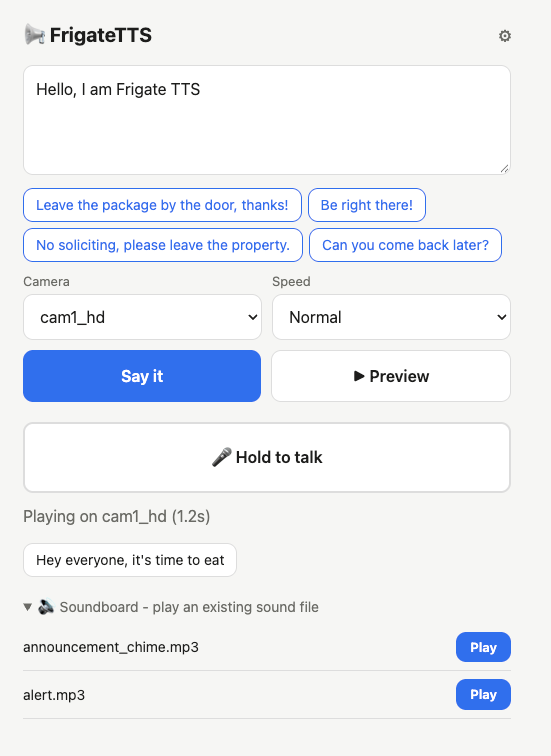

# frigate-tts

A tiny web app: type text, or hold a button and talk, and it plays through a CCTV camera's speaker via [Frigate](https://frigate.video)'s built-in go2rtc two-way audio.

Text -> [Piper](https://github.com/rhasspy/piper) TTS (offline) -> `/sounds/tts.wav` -> go2rtc `POST /api/streams?dst=<cam>&src=ffmpeg:/sounds/tts.wav#audio=pcma#input=file`

## Requirements

- Frigate running in Docker, with a host dir mounted at `/sounds`
- Cameras with two-way audio (backchannel) configured in [go2rtc](https://docs.frigate.video/configuration/go2rtc) (see also [two-way talk](https://docs.frigate.video/configuration/live#two-way-talk))
- Docker with Compose

## Setup

```sh
mkdir -p data voices
docker compose up -d --build   # http://<host>:5005
```

Everything else (cameras, the go2rtc URL, voice, padding, an announcement chime, history, push-to-talk mode, and an optional login) is configured from the Settings page (the gear icon on the main page) instead of environment variables, and is saved to `data/settings.json`, which survives rebuilds.

If `compose.yml`'s `networks.frigate.name` doesn't match Frigate's compose project name, change it so `http://frigate:1984` resolves (usually `<frigate-folder-name>_default`).

## Main page



- Type a message, or tap a quick reply (configured in Settings) to send it immediately.
- With more than one camera configured, the camera picker also offers "All cameras", which broadcasts to every one of them at once (typed messages, hold-to-talk, and the soundboard all support this).
- Preview plays the message in your browser, with the same padding it would get on a camera, no camera involved.
- Hold to talk records (or live-streams, depending on the push-to-talk mode in Settings) your voice to the camera.
- Soundboard plays any audio file already sitting in your sounds folder (e.g. a pre-made MP3), unmodified.

It's an installable PWA: "Add to Home Screen" (iOS Safari) or the install icon in the address bar (Chrome/Edge/Android) gets you an app icon that opens straight to this page, no browser chrome. Needs HTTPS (see below) to install on most platforms. The app's name on the home screen follows the "App name" setting.

## Settings page

- Cameras and connection: go2rtc URL, with a "Test connection" button that also lists the stream names go2rtc knows about. A rate limit here caps how many camera messages (of any kind) can go out per minute, as a leaky bucket; short bursts are fine, sustained spam isn't.
- Voice: pick from installed voices, or expand "Browse more voices" to search Piper's full catalog (free, no account needed) and download one on demand. Leading/trailing silence (padding) is also set here, along with a "Preview" box that plays in your browser only, never through a camera. "Play announcement chime" plays a supermarket-style two-tone chime before the message: leading silence, chime, half a second, then speech.
- Quick replies: canned phrases, one per line, shown as buttons on the main page that send immediately when clicked.
- History: show/hide the quick-reuse buttons on the main page; clicking one fills the message box rather than sending it immediately.
- Push to talk, two modes:
  - Record, then send (default): waits until you release the button, so the clip gets the full leading/trailing silence. Clearest audio.
  - Live: streams ~0.7s segments to the camera while you hold the button, so it starts playing within about a second, closer to a real PTT radio, but the first word can clip and there can be small gaps between segments.
- Login (Basic Auth): off by default. Set a username and password to require them for every page.

## Mic access over HTTPS

Browsers block microphone access on plain HTTP (except on `localhost`), so the hold-to-talk buttons won't work if you open this over plain `http://<lan-ip>:5005`. `compose.yml` includes a small [Caddy](https://caddyserver.com) sidecar that serves the same app over HTTPS, so:

```
https://<host>:8444
```

Your browser will warn about the self-signed cert the first time; that's expected, accept it once per device. (If you already reach this over Tailscale or another HTTPS tunnel, you don't need this proxy.)

### Ports and certificate

Both ports, and how the proxy gets its certificate, are set in `.env` (docker compose reads it automatically):

| Variable | Default | |
|---|---|---|
| `HTTP_PORT` | `5005` | host port for the plain HTTP app |
| `HTTPS_PORT` | `8444` | host port for the HTTPS proxy |
| `CADDYFILE` | `./Caddyfile.selfsigned` | which Caddy config to use |

`Caddyfile.selfsigned` (the default) issues a self-signed certificate on the fly for whatever hostname/IP you connect with; no setup beyond accepting the browser warning once per device.

To use a certificate you already have (from Let's Encrypt, your router, etc.) instead: uncomment the `./certs:/certs:ro` volume line in `compose.yml`, put your cert and key under a local `certs/` folder, and set in `.env`:

```
CADDYFILE=./Caddyfile.custom-cert
CERT_FILE=/certs/fullchain.pem
KEY_FILE=/certs/privkey.pem
```

Changing any of these needs `docker compose up -d` (not just a restart) to take effect.

## How it's built

Node.js and TypeScript, no web framework, using the built-in `http` module. Speech comes from [Piper's](https://github.com/rhasspy/piper) standalone CLI binary (downloaded for your architecture at image build time), piped through `ffmpeg` for the leading/trailing silence. The same approach pads a recorded clip. Live push-to-talk feeds audio into a named pipe that go2rtc reads from continuously while the button is held.

```
src/
  config.ts   settings persistence, auth, rate limiting, sound listing
  piper.ts    voice catalog/download, synthesis, go2rtc calls
  live.ts     the named-pipe push-to-talk session
  pages.ts    the two pages' HTML/CSS/JS
  server.ts   HTTP routing
```

## Configuration (env vars)

`npm start` reads `.env` (via `--env-file-if-exists`), and `docker compose` reads the same file for the port/certificate variables in the section above.

| Env var | Default | |
|---|---|---|
| `SOUNDS_DIR` | `/sounds` | where this app writes audio |
| `FRIGATE_SOUNDS_DIR` | `/sounds` | the same dir, as seen inside Frigate |
| `VOICES_DIR` | `/app/voices` | installed Piper voices |
| `PUBLIC_DIR` | `/app/public` | static assets (icons, manifest) |
| `SETTINGS_PATH` | `/data/settings.json` (or `./data/settings.json` outside Docker) | where settings are saved |
| `PORT` | `5005` | HTTP port |
| `GO2RTC_URL` | `http://frigate:1984` | first-run go2rtc URL; the Settings page owns it afterward |

## Running without Docker

Needs Node.js 22+ (`.nvmrc` pins 22.10), `ffmpeg`, and a [Piper release binary](https://github.com/rhasspy/piper/releases) for your platform on `PATH`.

```sh
npm install
npm run build
npm start
```

`npm start` loads `.env` automatically, so no inline env vars are needed. A local `.env` looks like:

```sh
SOUNDS_DIR=./sounds
FRIGATE_SOUNDS_DIR=/sounds
VOICES_DIR=./voices
PUBLIC_DIR=./public
SETTINGS_PATH=./data/settings.json
PORT=5005
GO2RTC_URL=http://192.168.0.6:1984
```

Then open the Settings page, check the go2rtc URL with "Test connection", and add your camera names.

One catch when developing against a *remote* Frigate: `Say it` writes `tts.wav` locally and asks go2rtc (on the Frigate host) to play `/sounds/tts.wav`. Those only line up if `./sounds` on this machine and `/sounds` on the Frigate host are the same files - share/mount them, or run this app on the Frigate host. Preview and voice download work regardless.

## Notes

- No authentication by default; until you set one up in Settings, anyone who can reach the port can talk through your cameras, and can change that setting themselves. Keep it on your LAN/VPN, or set a login.
- A rate limit (Settings -> Cameras and connection, default 10/min) protects against a runaway script or an accidental loop; set it to 0 to disable.
- Each typed/recorded message overwrites the same file; nothing accumulates. Live push-to-talk uses a temporary named pipe per session, cleaned up when you release the button (or after ~20s of inactivity if a session is abandoned).
- The soundboard only ever plays files already in your sounds folder; there's no file upload, and filenames are matched against that folder's own listing, so there's no path-traversal surface.

## License

[MIT](LICENSE)
